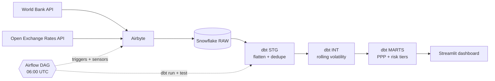
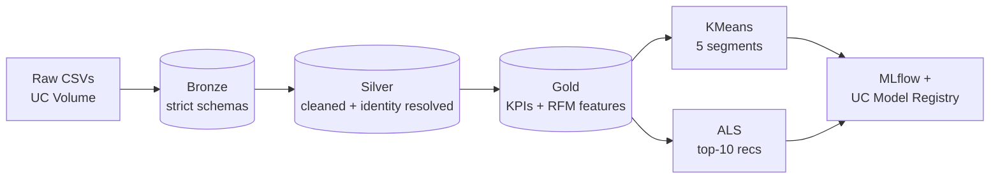

**Modern data stack · Lakehouse · Warehouse modelling · Cloud native pipelines **

-2ea44f?style=flat-square)

<
-->
<

-->

---

## 👋 About

I build data pipelines that turn raw, messy sources into trusted, documented, tested datasets that analysts and models can use without asking questions.

My first "SQL" was balancing branch ledgers. I spent ten years at **Punjab National Bank**, starting in branch operations and forex and finishing as **Data Engineer – ETL & Data Integration** in the Data Analytics Wing, working on enterprise ETL with Oracle, IBM DataStage and SQL.
I then completed an **MSc in Data Science at the University of Surrey** and now build cloud-native pipelines on the modern data stack.

That combination is my edge: I understand what a number means to the business that produces it, and I know how to move it reliably at scale.

---

## 🚀 Featured projects

| Project | What it demonstrates | Stack | Links |
|---|---|---|---|
| **[EconPulse Analytics](https://github.com/vishnusuresh87/econpulse-analytics)** | Automated ELT of World Bank and FX data, with incremental dbt models, sensor-based orchestration and a real-exchange-rate dashboard | Airbyte · Snowflake · dbt · Airflow · Streamlit | [Repo](https://github.com/vishnusuresh87/econpulse-analytics) |
| **[Spark E-Commerce Recommendation Pipeline](https://github.com/vishnusuresh87/spark-ecommerce-recommendation)** | Medallion lakehouse on Databricks with Unity Catalog governance, RFM segmentation and ALS recommendations, tested with pytest | Databricks · PySpark · Delta Lake · MLflow | [Repo](https://github.com/vishnusuresh87/spark-ecommerce-recommendation) |
| **[Cancer Recurrence Platform](https://github.com/vishnusuresh87/cancer-recurrence-platform)** | A data-to-model-to-app system: dbt warehouse, survival model, four microservices and a React client | dbt · PostgreSQL · Redis · Docker · React | [Repo](https://github.com/vishnusuresh87/cancer-recurrence-platform) |
| **[Biomedical NER with PubMedBERT](https://github.com/vishnusuresh87/NLP-token-classification)** | Fine-tuning a transformer for token classification, with error analysis and a deployed inference app | PubMedBERT · Hugging Face · Streamlit | [Repo](https://github.com/vishnusuresh87/NLP-token-classification) · [Live app](https://nlp-token-classification-biomedical-ner.streamlit.app/) |

<b>EconPulse: how the pipeline fits together</b>

<b>Lakehouse pipeline: Bronze → Silver → Gold → ML</b>

---

## Tech stack

| Area | Tools |
|---|---|
| **Warehouse & Lakehouse** |     |
| **Transform & Orchestrate** |     |
| **Languages** |    |
| **ML & NLP** |    |
| **Cloud & DevOps** |     |
| **Enterprise & Legacy ETL** |   |
| **Serving & Apps** |    |

---

## What I'm focused on

- **Data modelling:** dimensional design, medallion layers, incremental strategies
- **Modern data stack:** dbt, Airflow, Airbyte, Databricks, open table formats
- **Data quality:** tests, freshness checks, reconciliation (a habit from banking)
- **Currently studying:** GCP Professional Data Engineer
- **Also exploring:** agentic AI, deep learning and LLMs

---

## 🤝 Let's talk

I'm looking for **Data Engineer / Analytics Engineer** roles in the UK, and I'm happy to collaborate on open-source ETL, BI and ML projects.

- [LinkedIn](https://www.linkedin.com/in/vishnusuresh87/)

